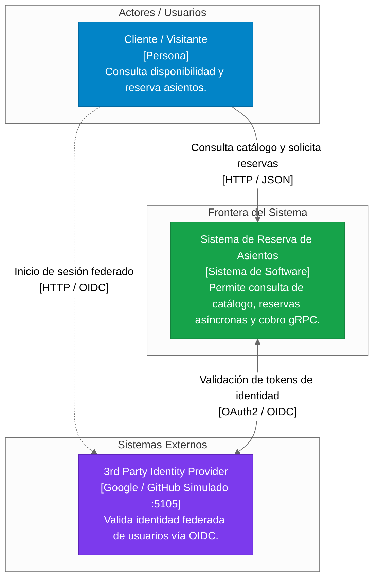

# C4 Model - Nivel 1: Contexto del Sistema (System Context)
**Sistema:** Plataforma Distribuida de Reserva de Asientos 
**Cátedra:** Programación IV / Sistemas Distribuidos - UTN FRBA (Grupo 2) 

## Descripción
Representa la interacción de alto nivel entre los usuarios finales, la frontera del sistema de reservas y los proveedores de identidad externos delegados.

