# C4 Model - Nivel 2: Contenedores (Container Diagram)
**Frontera Arquitectónica:** Microservicios con Persistencia Aislada (*Database-per-Service*) y Asincronismo.

## Descripción
Detalla los procesos y almacenes de datos que componen la solución en Docker, destacando la frontera de consistencia eventual entre Availability y Booking.

```mermaid
%%{init: {
  'theme': 'base',
  'themeVariables': {
    'fontSize': '13px',
    'fontFamily': 'Segoe UI, Helvetica, sans-serif',
    'textColor': '#f8fafc',
    'lineColor': '#94a3b8',
    'edgeLabelBackground': '#1e293b'
  }
}}%%
flowchart TB
    User["👤 Cliente / Navegador Web"]

    subgraph CoreContainers["Contenedores del Sistema"]
        AuthServer["🔐 Auth Server\n[ASP.NET Core Web API :5104]\nEmisión de tokens JWT (HS256) M2M y Password Grant."]
        ExtIdP["🔑 External IdP\n[ASP.NET Core :5105]\nSimulador de Google/GitHub (OIDC)."]

        AvailApp["🌐 Availability Site & API\n[Clean Architecture :5101]\nCatálogo público y recepción asíncrona."]
        AvailDb[("💾 Availability DB\n[SQLite]\nCatálogo local.")]

        Broker["📬 Message Broker\n[Azure Service Bus Cloud]\nTopic 'grupo2-booking-topic'"]

        BookingApp["⚙️ Booking API & Workers\n[N-Layer :5102]\nNúcleo transaccional de reservas."]
        BookingDb[("💾 Booking DB\n[SQLite]\nExclusión mutua y locking.")]

        PaymentApp["💳 Payment Service\n[N-Layer gRPC :5103]\nPasarela financiera HTTP/2 + Protobuf."]
        PaymentDb[("💾 Payment DB\n[SQLite / Ledger]\nLibro contable inmutable.")]

        NotifWorker["📢 Notifications Worker\n[Background Service]\nProcesamiento asíncrono de alertas."]
    end

    User -->|"1. Consulta / Reserva\n[HTTP :5101]"| AvailApp
    User -.->|"Login federado"| ExtIdP
    ExtIdP --> AuthServer
    AvailApp -->|"Token M2M"| AuthServer
    AvailApp --- AvailDb

    AvailApp -->|"2. POST Reserva (HTTP 202)\nPublica evento"| Broker
    
    subgraph AP_Boundary["Frontera de Consistencia Eventual (Brewer AP)"]
        Broker -.->|"3. Desencola mensaje asíncrono"| BookingApp
    end

    BookingApp --- BookingDb
    BookingApp -->|"4. Cobro sincrónico gRPC\n[HTTP/2 + Polly]"| PaymentApp
    PaymentApp --- PaymentDb

    BookingApp -->|"5. Evento ReservationConfirmed"| NotifWorker
    NotifWorker -.->|"6. Simula envío de notificación"| User

    classDef web fill:#0284c7,stroke:#0369a1,color:#fff;
    classDef srv fill:#16a34a,stroke:#15803d,color:#fff;
    classDef grpc fill:#4f46e5,stroke:#3730a3,color:#fff;
    classDef db fill:#475569,stroke:#334155,color:#fff;
    classDef broker fill:#d97706,stroke:#b45309,color:#fff;
    classDef auth fill:#7c3aed,stroke:#5b21b6,color:#fff;

    class AvailApp web;
    class BookingApp srv;
    class PaymentApp grpc;
    class AvailDb,BookingDb,PaymentDb db;
    class Broker broker;
    class AuthServer,ExtIdP auth;

    style AP_Boundary fill:#1e293b,stroke:#f59e0b,stroke-width:2px,stroke-dasharray: 6 6;
```

