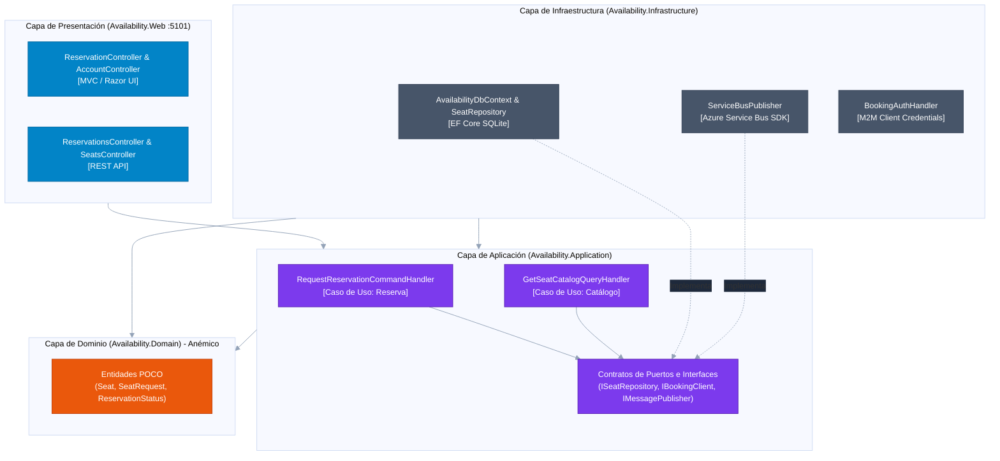

# C4 Model - Nivel 3: Componentes de Availability (Clean Architecture)
**Patrón:** Clean Architecture (Onion Architecture) con Dominio Anémico.

## Estructura de Capas
Las dependencias apuntan **estrictamente hacia adentro**:
- **Web / Presentation:** Controladores MVC Razor y API REST.
- **Application:** Casos de uso (`Commands`, `Queries`, contratos de puertos).
- **Domain:** Entidades anémicas (`Seat`, `SeatRequest`).
- **Infrastructure:** Implementación de persistencia EF Core, cliente de Service Bus y tokens M2M.

