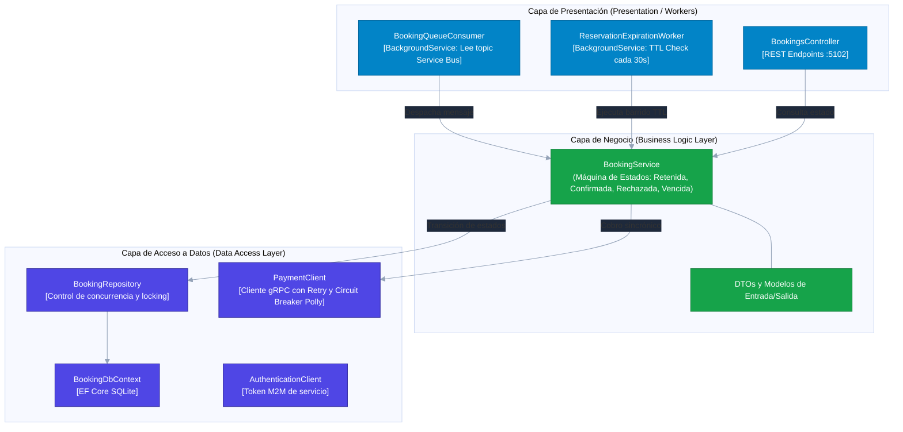

# C4 Model - Nivel 3: Componentes de Booking (N-Layer)
**Patrón:** N-Layer clásico (Presentation $\to$ Business $\to$ DataAccess) con Dominio Anémico.

## Estructura de Capas
1. **Presentation:** Controladores REST y Workers en segundo plano (`HostedServices`).
2. **Business:** Lógica transaccional de máquina de estados (`BookingService`).
3. **DataAccess:** Repositorio, contexto EF Core SQLite y cliente gRPC hacia Payment protegido con Polly.

