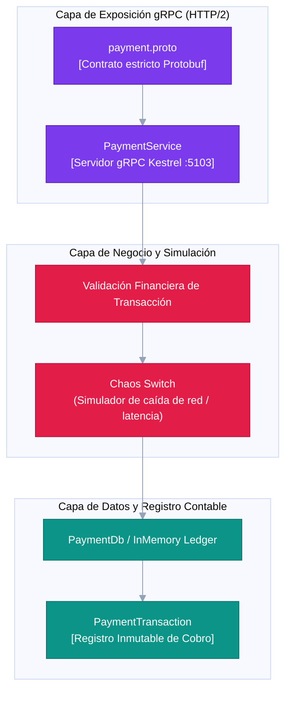

# C4 Model - Nivel 3: Componentes de Payment (N-Layer gRPC)
**Patrón:** N-Layer con interfaz binaria gRPC sobre HTTP/2.

## Descripción
Expone el contrato de cobro financiero y alberga el interruptor de fallos simulados (*Chaos Switch*) para las pruebas de resiliencia.

