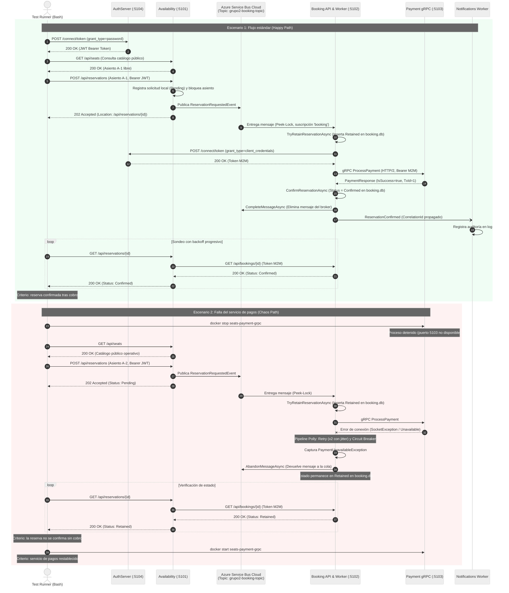

# Diagrama de Secuencia: Flujo de Testing E2E
**Cátedra:** Programación IV / Sistemas Distribuidos - UTN FRBA 
**Requisito:** 3.j (Ejecución automatizada de Happy Path y Fallo de Componente) 
**Script:** `scripts/test-e2e-scenarios.sh`

