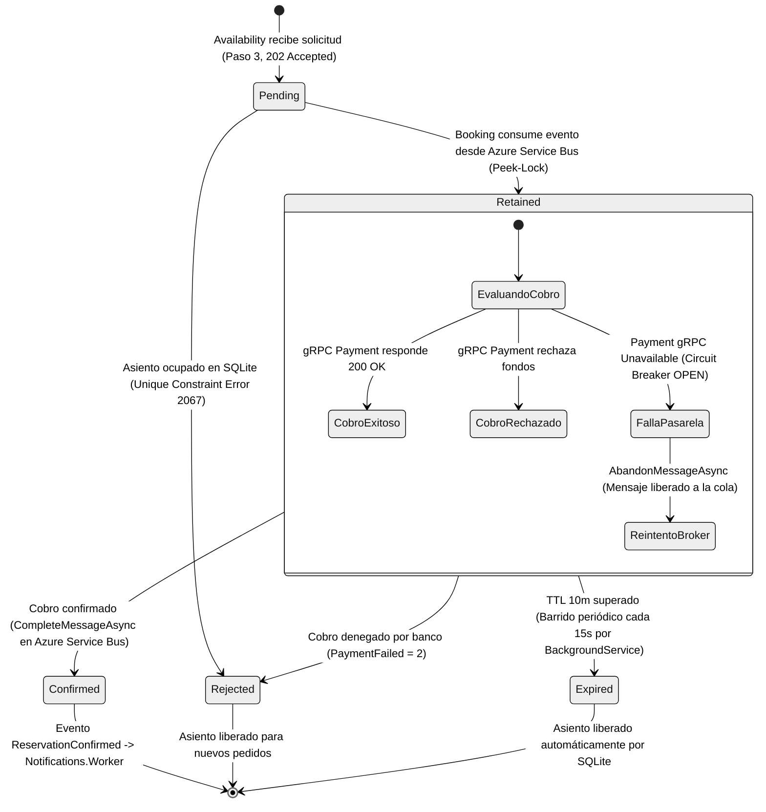

# Máquina de Estados de la Reserva y Ciclo de Vida Distribuido
**Cátedra:** Programación IV / Sistemas Distribuidos - UTN FRBA 
**Modelado:** Alineado a la implementación real de `BookingService.cs` y `ReservationExpirationWorker.cs`.

