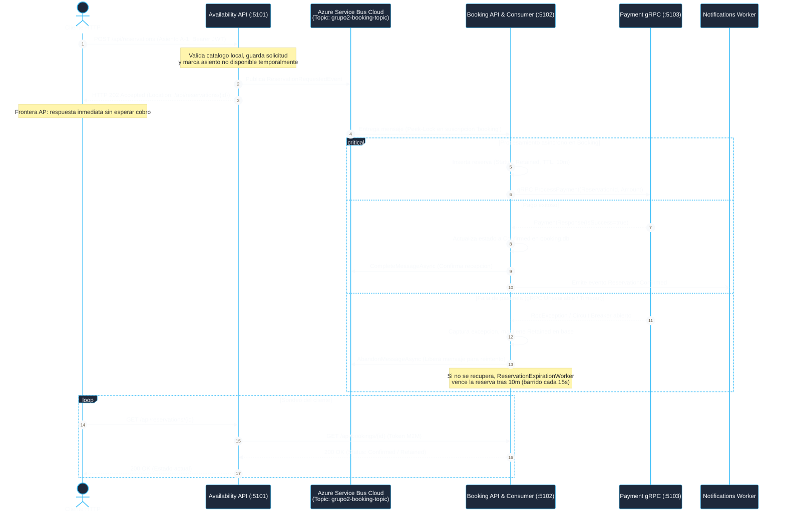

# Diagrama de Secuencia: Consistencia Eventual y Frontera AP
**Cátedra:** Programación IV / Sistemas Distribuidos - UTN FRBA  
**Requisitos:** 3.a, 3.b, 3.g (Frontera de Consistencia Eventual y Asincronismo)

