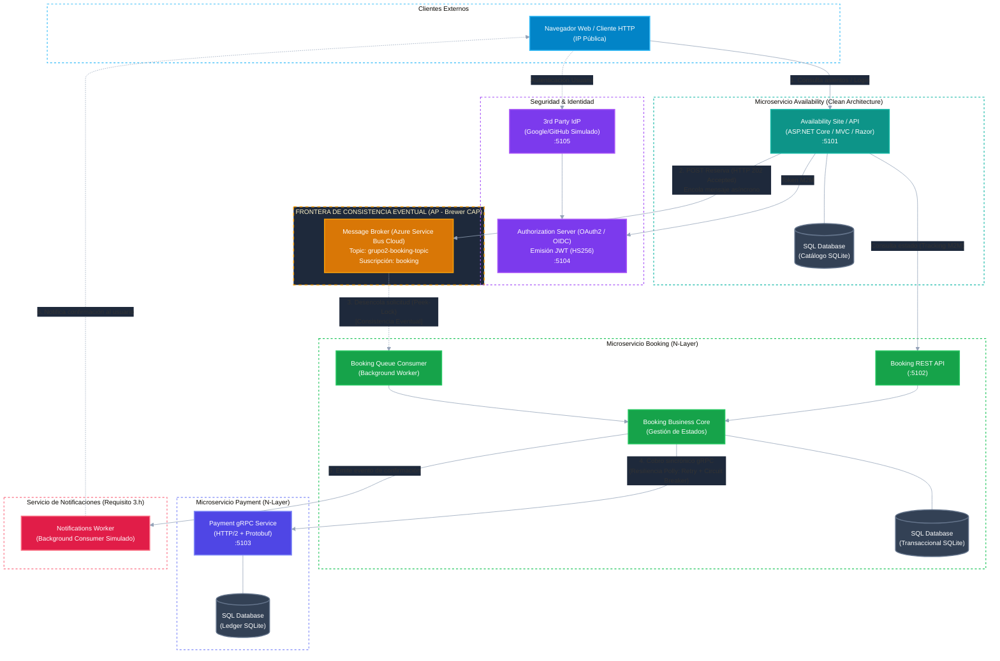
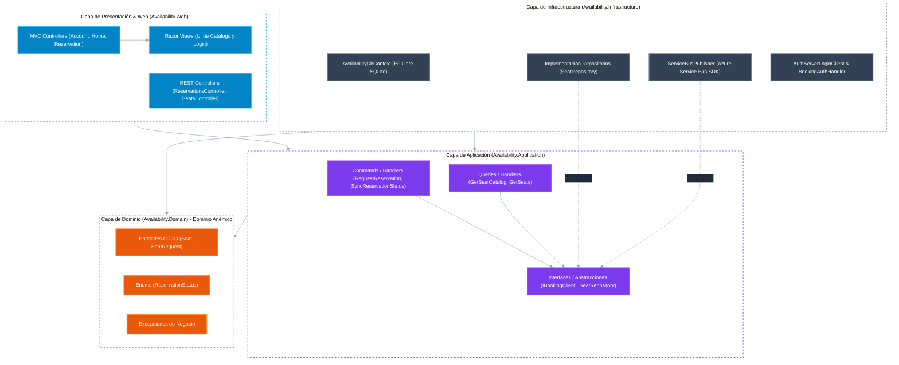
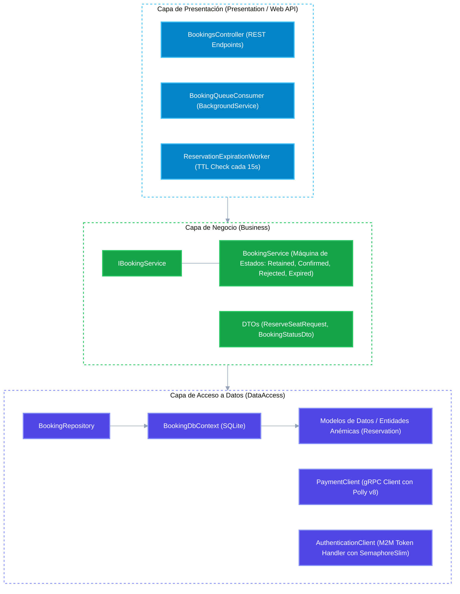
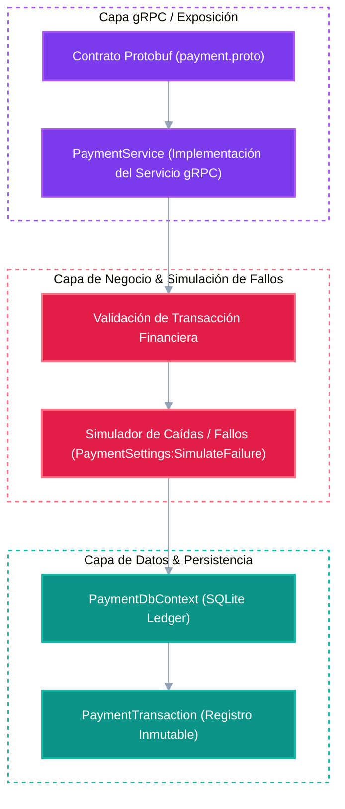
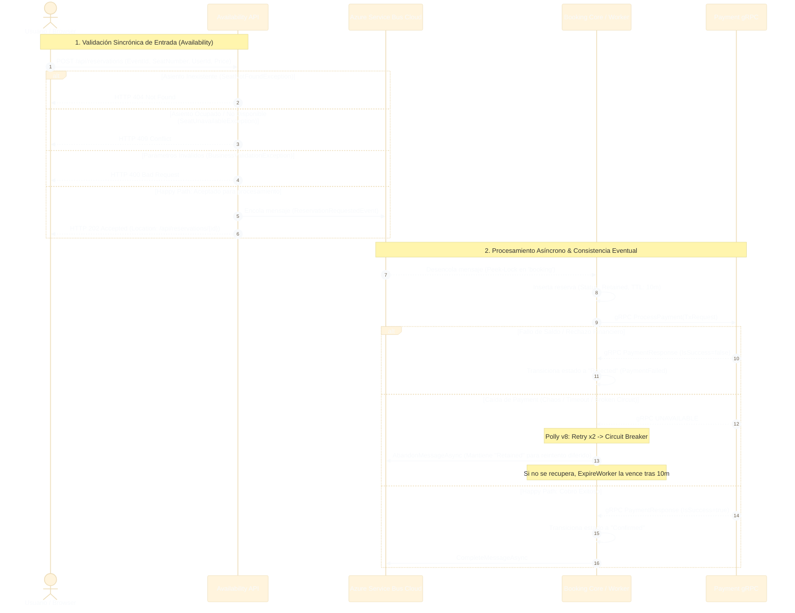

# Diagramas de Arquitectura de Software
**Materia:** Programación IV / Sistemas Distribuidos - UTN FRBA  
**Trabajo Práctico:** Sistema de Reserva de Asientos - Grupo 2  
**Estilo Arquitectónico:** Microservicios  

---

## 1. Diagrama General del Sistema y Despliegue (Requisitos 3.d, 3.g, 3.h)
El sistema adopta un estilo de **Microservicios** con persistencia políglota y bases de datos aisladas (*Database-per-Service*).  
La interacción entre **Availability** y **Booking** se realiza a través de un Message Broker asíncrono (**Azure Service Bus Cloud**, topic `grupo2-booking-topic`), marcando la frontera estricta de **Consistencia Eventual (*Eventual Consistency*)**.

> **Nota de Cátedra sobre Consistencia Eventual (Requisito 3.g):**  
> Cuando el cliente solicita reservar un asiento, **Availability** valida la existencia en catálogo y responde **inmediatamente con código HTTP 202 Accepted**, registrando la solicitud localmente y enviando el evento al broker. La confirmación definitiva la ejecuta **Booking** de forma asíncrona; la consistencia entre catálogo y reserva es **eventual**.

---

## 2. Diagrama de Arquitectura: Availability Site / API (Requisito 3.a, 3.i)
Sigue estrictamente el patrón **Clean Architecture (Onion Architecture)** con **Dominio Anémico**:
- Las dependencias apuntan **hacia adentro**.
- `Availability.Domain` no tiene dependencias de infraestructura ni frameworks.
- La persistencia y el cliente de mensajería implementan interfaces definidas en la capa de aplicación.

---

## 3. Diagrama de Arquitectura: Booking REST API (Requisito 3.b, 3.i)
Implementado bajo el patrón arquitectónico clásico **N-Layer (Multicapa)** con **Dominio Anémico**:

---

## 4. Diagrama de Arquitectura: Payment gRPC Service (Requisito 3.c, 3.i)
Diseñado bajo patrón **N-Layer**, exponiendo interfaz de alto rendimiento HTTP/2 con Protobuf:

---

## 5. Flujo Dinámico y Gestión de Errores (Happy Path & Fallos)
Muestra el ciclo de vida completo de una solicitud de reserva, incluyendo la validación síncrona en el frontend/API, la frontera asíncrona de consistencia eventual y la resiliencia en el cobro con Polly.

### Matriz de Mapeo: Excepciones de Dominio a Códigos HTTP/gRPC

| Escenario / Excepción | Capa Origen | Código de Respuesta | Efecto en el Sistema |
| :--- | :--- | :--- | :--- |
| **Happy Path (Encolado)** | `Availability.Web` | `HTTP 202 Accepted` | Solicitud aceptada en broker; consistencia eventual en marcha. |
| `BusinessValidationException` | `Availability.Domain` | `HTTP 400 Bad Request` | Falla validación de entrada; no se encola nada. |
| `InvalidReservationRequestException` | `Availability.Domain` | `HTTP 400 Bad Request` | Payload mal formado o faltan campos obligatorios. |
| `SeatNotFoundException` | `Availability.Domain` | `HTTP 404 Not Found` | El asiento solicitado no existe en el catálogo. |
| `SeatUnavailableException` | `Availability.Domain` | `HTTP 409 Conflict` | El asiento ya se encuentra reservado o no disponible. |
| `ReservationUserMismatchException` | `Availability.Domain` | `HTTP 403 Forbidden` | Discrepancia entre el usuario autenticado (token `sub`) y el cuerpo de la solicitud. |
| `Payment Error` | `Payment.gRPC` | `gRPC PaymentResponse (IsSuccess=false)` | Fondos insuficientes; reserva pasa a `Rejected (PaymentFailed)`. |
| `Payment Service Down` | `Booking -> Payment` | `Polly Circuit Breaker / Abandon` | Falla gRPC interceptada; mensaje liberado a la cola para reintento diferido. |
